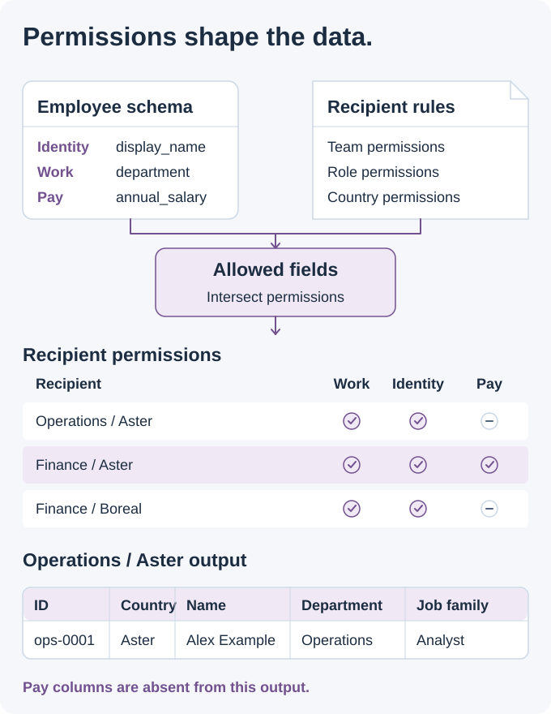

# PolicyForge | Permission-Aware Development Data

> [!CAUTION]
> **Confidential work and public design.** This showcase contains no Thales implementation or data and carries no employer endorsement. The original generator is unavailable; this repository contains its public design and static example files, not a runnable generator. The expanded delivery controls are design recommendations. Country rules and records are fictional, and diagrams explain the design.

## Give each development team the data shape it is allowed to use

PolicyForge addresses a practical development problem: teams working with the same business data may have different access to countries, records and fields. I developed a configurable synthetic-data generator that shaped development datasets around those permissions, so developers could build screens, reports and integrations against the fields available to their users.

**My contribution:** configurable data generation based on the recipient's team, role, country scope and permitted fields.

<picture>
  <source media="(prefers-color-scheme: dark) and (max-width: 540px)" srcset="assets/policy-story-v4-mobile-dark.svg">
  <source media="(max-width: 540px)" srcset="assets/policy-story-v4-mobile-light.svg">
  <source media="(prefers-color-scheme: dark)" srcset="assets/policy-story-v4-dark.svg">
  
</picture>

### What I built

- Configurable generation for different recipient teams and roles.
- Country scope and field permissions that determine the recipient's dataset shape.
- Development data shaped for the recipient's permitted view of the business subject.

### Same subject, different outputs

| Recipient | Available data |
| --- | --- |
| Operations in Aster | Identity and work fields, without salary or bonus columns. |
| Finance in Aster | Identity and work fields, plus salary, bonus and currency. |
| Finance in Boreal | Identity and work fields; country rules remove financial columns. |
| Partner in Aster | Department and job-family fields, without names or financial columns. |

Country access and field access are separate decisions. Finance can receive a Boreal dataset with fewer columns. A partner requesting Boreal is refused because that country is outside the recipient's scope.

For a developer, the difference is visible in the schema: a report must handle an absent salary column instead of depending on information its user cannot receive.

<details>
<summary><strong>Engineering details: schemas, permissions, and export rules</strong></summary>

### Select permitted fields before generating values

The [employee schema](https://github.com/MahdiHajjHassan/policy-aware-data-generator/blob/main/examples/employee-schema.json) defines types, required fields, relationships and field categories. The [policy file](https://github.com/MahdiHajjHassan/policy-aware-data-generator/blob/main/policies.example.json) combines dataset, team, role and country permissions:

```text
allowed categories = dataset ∩ team ∩ role ∩ country
allowed fields = fields in those categories minus explicit denials
```

The design checks requested countries first, then shapes each country's output using its field rules. Restricted columns are absent from the schema and records.

### Export control design

- Resolve identity, team and roles from authenticated context.
- Generate values only for the selected permitted fields.
- Keep country schemas separate when their permitted columns differ.
- Validate required fields, types, identifiers and relationships before delivery.
- Reject unauthorized countries, unknown fields and broken relationships.
- Recheck permissions on export retries and downloads.

<picture>
  <source media="(prefers-color-scheme: dark)" srcset="assets/recipient-data-v2-dark.svg">
  
</picture>

### Inspect the configuration and outputs

- Compare [operations](https://github.com/MahdiHajjHassan/policy-aware-data-generator/blob/main/examples/operations.json), [Aster finance](https://github.com/MahdiHajjHassan/policy-aware-data-generator/blob/main/examples/finance-aster.json), [Boreal finance](https://github.com/MahdiHajjHassan/policy-aware-data-generator/blob/main/examples/finance-boreal.json) and [partner](https://github.com/MahdiHajjHassan/policy-aware-data-generator/blob/main/examples/partner-aster.json) datasets.
- Inspect the [expected decisions](https://github.com/MahdiHajjHassan/policy-aware-data-generator/blob/main/examples/expected-decisions.json) and [export manifest](https://github.com/MahdiHajjHassan/policy-aware-data-generator/blob/main/examples/export-manifest.example.json).
- Read the [policy and generation design](https://github.com/MahdiHajjHassan/policy-aware-data-generator/blob/main/docs/reference-design.md) and [validation scenarios](https://github.com/MahdiHajjHassan/policy-aware-data-generator/blob/main/docs/acceptance-scenarios.md).

</details>

[Back to my portfolio](https://github.com/MahdiHajjHassan)
