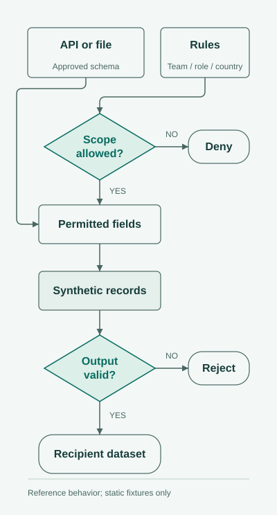

# Policy-aware synthetic data generator

I developed a configurable dummy-data generator for teams that need different views of a dataset. An operations team might need assignments and departments, while finance also needs financial fields; country rules can narrow either team's access.

This repository explains the approach with a reference design, policy configuration, and fictional fixtures. The original implementation is unavailable; this repository contains no runnable generator.

## How a recipient's dataset is shaped

<picture>
  <source media="(prefers-color-scheme: dark)" srcset="assets/recipient-data-dark.svg">
  
</picture>

The design combines the dataset contract with recipient permissions before generating records. Restricted fields are omitted, country restrictions narrow broader permissions, and unauthorized scope is rejected. Source records are not copied into the public examples.

## Different recipients, different development views

| Recipient | Example data provided | Data excluded |
| --- | --- | --- |
| Operations | Department, job family, and fabricated identity fields | Financial fields |
| Finance in Aster | Work information and fabricated financial values | Fields outside the declared policy |
| Finance in Boreal | Work information and fabricated identity fields | Financial fields restricted by country policy |
| Partner in Aster | A limited operational subset | Identity and financial fields |

Aster and Boreal are fictional countries. Their rules illustrate configuration behavior, not real legal requirements.

## Technical detail and examples

- [Reference design](docs/reference-design.md): input contracts, policy precedence, generation boundaries, validation, and delivery recommendations.
- [Policy configuration](policies.example.json): team, role, country, and field-category rules.
- [Example outputs](examples): static fabricated records for different recipients.
- [Acceptance scenarios](docs/acceptance-scenarios.md): expected approvals and denials.

The diagram describes reference behavior. Fixtures illustrate output shapes; additional audit and delivery controls are recommendations, not verified production features.

[Mahdi Hajj Hassan](https://github.com/MahdiHajjHassan)
