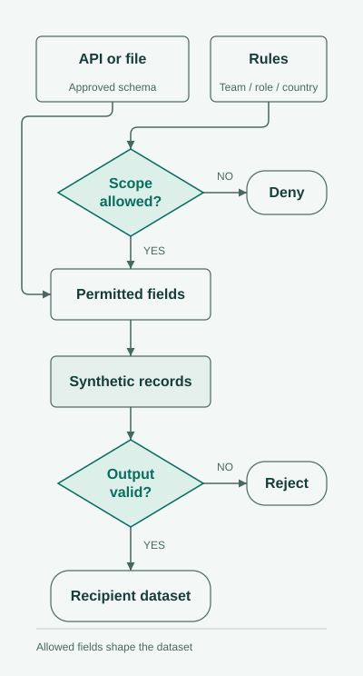

# PolicyForge | Permission-Aware Development Data

> [!CAUTION]
> **Confidential work and public design.** This showcase contains no Thales implementation or data and carries no employer endorsement. The original generator is unavailable; this repository contains its public design and static example files, not a runnable generator. The expanded delivery controls are design recommendations. Country rules and records are fictional, and diagrams explain the design.

## Development datasets that match each team's access

Developers need data to build and check screens, reports, and integrations. An operations team and a finance team may work with the same subject but receive different fields. I developed a configurable synthetic-data generator that shaped datasets around those differences.

**My contribution:** configurable generation based on the recipient's team, role, country scope, and permitted fields. The goal was to let teams develop against the data shape they were allowed to use.

<picture>
  <source media="(prefers-color-scheme: dark) and (max-width: 540px)" srcset="assets/policy-story-v3-mobile-dark.svg">
  <source media="(max-width: 540px)" srcset="assets/policy-story-v3-mobile-light.svg">
  <source media="(prefers-color-scheme: dark)" srcset="assets/policy-story-v3-dark.svg">
  
</picture>

### Same subject, different fields

| Recipient | Dataset shape |
| --- | --- |
| Operations in Aster | Identity and work fields, without salary or bonus columns. |
| Finance in Aster | Identity and work fields, plus salary, bonus, and currency. |
| Finance in Boreal | Identity and work fields; the country's rule removes financial columns. |
| Partner in Aster | Department and job-family fields, without names or financial columns. |

The country and field decisions are separate. Finance can receive a Boreal dataset with fewer columns. A partner requesting Boreal is refused because the country itself is outside that recipient's access.

This matters to development: a report should handle an omitted salary column correctly, rather than depending on information its intended user cannot receive.

<details>
<summary><strong>Engineering details: schemas, permissions, and export rules</strong></summary>

### Define fields before generating values

The [employee schema](https://github.com/MahdiHajjHassan/policy-aware-data-generator/blob/main/examples/employee-schema.json) defines types, required fields, relationships, and field categories. The [policy file](https://github.com/MahdiHajjHassan/policy-aware-data-generator/blob/main/policies.example.json) combines dataset, team, role, and country permissions:

```text
allowed categories = dataset ∩ team ∩ role ∩ country
allowed fields = fields in those categories minus explicit denials
```

Requested countries are checked first. Field rules then shape each country's output. Restricted columns are absent from both the schema and the records.

### Design decisions

- Resolve identity, team, and roles from authenticated context; a request cannot grant itself a finance role.
- Generate values within the permitted field list.
- Keep separate country schemas when their permitted columns differ.
- Validate required fields, types, identifiers, and relationships before delivery.
- Reject unauthorized countries, unknown fields, or broken relationships.
- Check permissions again when an export is retried or downloaded.

<picture>
  <source media="(prefers-color-scheme: dark)" srcset="assets/recipient-data-v2-dark.svg">
  
</picture>

### Compare the outputs and rules

- [Operations](https://github.com/MahdiHajjHassan/policy-aware-data-generator/blob/main/examples/operations.json), [Aster finance](https://github.com/MahdiHajjHassan/policy-aware-data-generator/blob/main/examples/finance-aster.json), [Boreal finance](https://github.com/MahdiHajjHassan/policy-aware-data-generator/blob/main/examples/finance-boreal.json), and [partner](https://github.com/MahdiHajjHassan/policy-aware-data-generator/blob/main/examples/partner-aster.json) datasets.
- [Expected decisions](https://github.com/MahdiHajjHassan/policy-aware-data-generator/blob/main/examples/expected-decisions.json) and [export manifest](https://github.com/MahdiHajjHassan/policy-aware-data-generator/blob/main/examples/export-manifest.example.json).
- [Policy and generation design](https://github.com/MahdiHajjHassan/policy-aware-data-generator/blob/main/docs/reference-design.md).
- [Validation scenarios](https://github.com/MahdiHajjHassan/policy-aware-data-generator/blob/main/docs/acceptance-scenarios.md).

</details>

[Back to my portfolio](https://github.com/MahdiHajjHassan)
