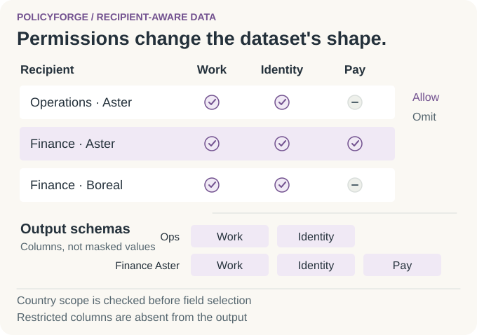

# PolicyForge

> [!CAUTION]
> **Professional experience, protected information.**
> This public showcase uses independent reference designs and fictional examples, with no Thales implementation or data. It discloses no employer code, systems, configuration, or critical information and carries no official endorsement. Diagrams explain the design; they are illustrations, not application screenshots or execution results. PolicyForge publishes a design and static fixtures; the original generator is unavailable. Expanded delivery controls are design recommendations, not verified features of that implementation. Example policies are not legal requirements.

## Recipient-aware synthetic data

I developed a configurable synthetic-data generator for teams that needed different views of a dataset. The question behind the work is simple: **what should this recipient be able to work with?**

An operations team needs departments and assignments. Finance may also need financial fields. A partner can need a smaller operational view, and country rules can narrow any of those views. Useful development data should reflect those differences: a screen or report should not depend on a column its recipient would never receive.

My contribution was the configurable generator work: establish the recipient's scope, determine the permitted fields, and shape the synthetic dataset around that contract.

<picture>
  <source media="(prefers-color-scheme: dark) and (max-width: 540px)" srcset="assets/policy-story-v3-mobile-dark.svg">
  <source media="(max-width: 540px)" srcset="assets/policy-story-v3-mobile-light.svg">
  <source media="(prefers-color-scheme: dark)" srcset="assets/policy-story-v3-dark.svg">
  
</picture>

### One dataset, different working views

Imagine development teams preparing an employee dashboard in the countries **Aster** and **Boreal**. Everyone starts from the same declared dataset, but they should not all build against the same columns.

There are two separate decisions. **Recipient selection** asks whether the team and role may request those countries. **Field rules** decide which columns belong in an allowed request. Finance can request Boreal under the example policy, but Boreal's restriction removes financial fields. A partner cannot request Boreal at all.

The existing public fixtures make those differences visible:

| Recipient | Example record | What the view contains |
| --- | --- | --- |
| Operations in Aster | `ops-0001`, **Alex Example** | Country, name, department, and job family; no financial fields. |
| Finance in Aster | `fin-as-0001`, **Morgan Example** | Work and identity fields, plus `annual_salary: 54000`, `annual_bonus: 4000`, and currency marker `DEM`. |
| Finance in Boreal | `fin-bo-0001`, **Taylor Example** | Work and identity fields; financial columns are absent. |
| Partner in Aster | `partner-as-0001` | Country, department, and job family; `display_name` and financial columns are absent. |

The distinction matters to the development team using the data. Finance in Boreal needs a valid view without salary columns; a partner requesting Boreal needs an explicit refusal. Those are different situations, and the reference makes each decision visible.

---

<details>
<summary><strong>Engineering decisions: contracts, policy rules, and failure cases</strong></summary>

### Define the shape before generating values

The reference begins with a dataset contract: fields, types, required values, classifications, and relationships. The [employee schema](https://github.com/MahdiHajjHassan/policy-aware-data-generator/blob/main/examples/employee-schema.json) separates structural, identity, work, and financial fields.

The design uses approved metadata and generation constraints rather than copying source records. Recipient identity, team membership, and assigned roles come from trusted authorization context; submitting `finance_analyst` in a request would not grant that role.

### A policy that narrows at every layer

The [example policy](https://github.com/MahdiHajjHassan/policy-aware-data-generator/blob/main/policies.example.json) uses this rule for each permitted country:

```text
permitted categories = dataset ∩ team ∩ role ∩ country
permitted fields = declared fields in those categories − explicit denials
```

Country access is checked first. Every requested country must be permitted by both the team and the role. Field categories can then narrow an authorized view; an explicit denial removes a field even when its category is allowed.

- **Omit restricted fields entirely.** A forbidden column is absent from both schema and records, rather than returned as a masked string, hash, or empty value.
- **Keep country schemas explicit.** Aster and Boreal finance have different field lists, so the reference defines separate country partitions.
- **Generate within the allowed shape.** Compile the permitted fields before generating values; check every record against that list before delivery.
- **Keep recipient packages independent.** Generated identifiers belong to their package. The relationship contract keeps child records within the same permitted package and country partition.

### The cases that make the rules meaningful

| Situation | Expected reference behavior |
| --- | --- |
| Partner requests Aster and Boreal together | Reject the entire request; do not silently deliver Aster alone. |
| Unknown team, role, country, or dataset | Deny the request. |
| A schema change introduces an unclassified field | Block the affected export until classification is reviewed. |
| A prohibited field is required by the output contract | Reject the export rather than release a broken dataset. |
| A record contains an extra financial property | Reject before delivery, even if the declared field list looks correct. |
| A required child reference cannot resolve within the package | Reject or require an explicitly different contract. |
| A delivery retry follows a permission change | Reauthorize before retrying. |

### From policy to recipient output

<picture>
  <source media="(prefers-color-scheme: dark)" srcset="https://raw.githubusercontent.com/MahdiHajjHassan/policy-aware-data-generator/main/assets/recipient-data-dark.svg">
  
</picture>

### Inspect the public material

- [Policy, generation, and delivery design](https://github.com/MahdiHajjHassan/policy-aware-data-generator/blob/main/docs/reference-design.md)
- [Operations](https://github.com/MahdiHajjHassan/policy-aware-data-generator/blob/main/examples/operations.json), [Aster finance](https://github.com/MahdiHajjHassan/policy-aware-data-generator/blob/main/examples/finance-aster.json), [Boreal finance](https://github.com/MahdiHajjHassan/policy-aware-data-generator/blob/main/examples/finance-boreal.json), and [Aster partner](https://github.com/MahdiHajjHassan/policy-aware-data-generator/blob/main/examples/partner-aster.json) fixtures
- [Expected policy decisions](https://github.com/MahdiHajjHassan/policy-aware-data-generator/blob/main/examples/expected-decisions.json) and [illustrative export manifest](https://github.com/MahdiHajjHassan/policy-aware-data-generator/blob/main/examples/export-manifest.example.json)
- [Acceptance scenarios and expected decisions](https://github.com/MahdiHajjHassan/policy-aware-data-generator/blob/main/docs/acceptance-scenarios.md)

</details>

[Mahdi Hajj Hassan](https://github.com/MahdiHajjHassan)
